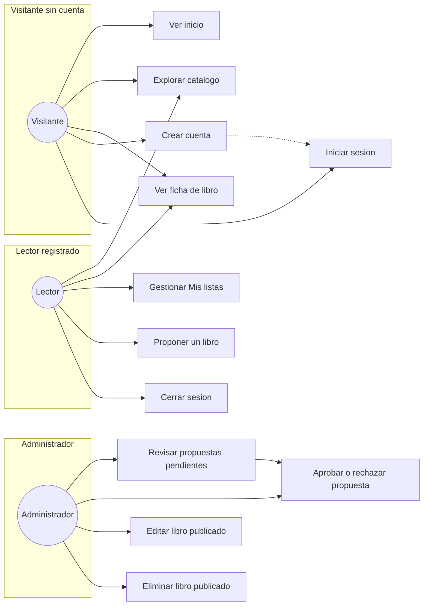
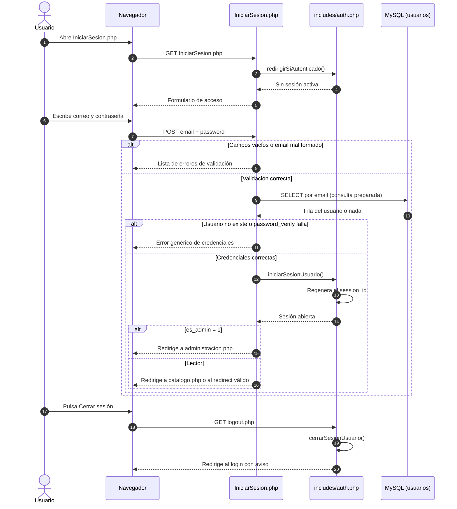
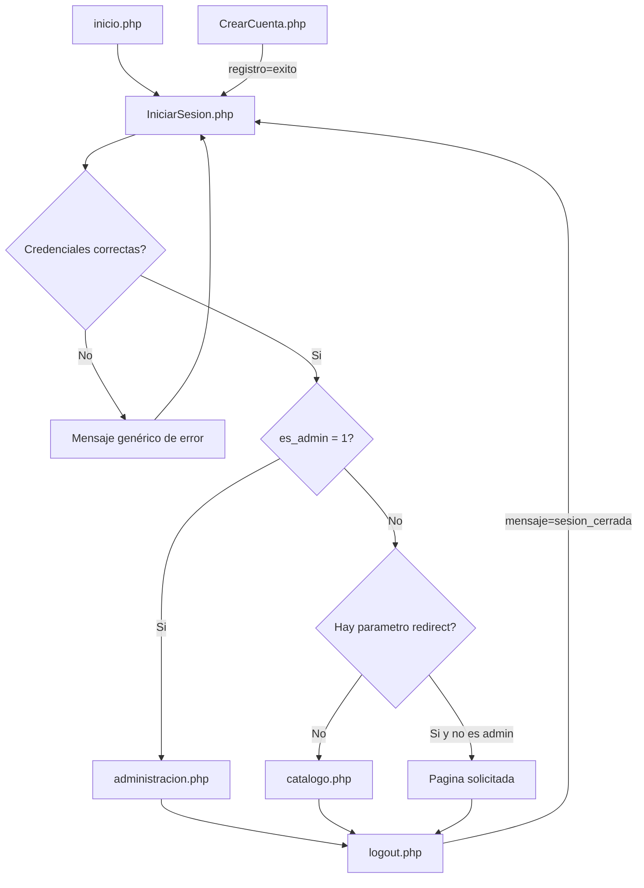

# BookVerse — Guía del usuario y registro de pruebas (borrador)
---

## 1. Qué es BookVerse

BookVerse es una web para descubrir libros, guardarlos en listas de lectura y proponer títulos nuevos al catálogo.

Hay dos perfiles:

| Perfil | Cómo se obtiene | Qué puede hacer |
| --- | --- | --- |
| Lector | Registrándose en la web (`es_admin` se fuerza a 0) | Navegar el catálogo, ver fichas, usar sus listas, proponer libros |
| Administrador | Marcando `es_admin` = 1 en la tabla `usuarios` | Todo lo anterior más el panel de moderación |

No se puede crear un administrador desde el formulario de registro: el `INSERT` de `CrearCuenta.php` escribe `es_admin = 0` de forma explícita.

**Estado del prototipo.** Lo único conectado a base de datos es el registro, el inicio de sesión y el cierre de sesión. El catálogo, las fichas de libro, Mis listas, el formulario de propuesta y el panel de administración son maquetas con datos de ejemplo: sus botones no guardan nada. Cada apartado lo indica.

---

## 2. Primeros pasos

1. Arranca Apache y MySQL en XAMPP y copia el proyecto en `htdocs`.
2. Copia `config.example.php` como `config.php` y pon las credenciales de tu MySQL local. `config.php` está ignorado por Git.
3. Importa la base de datos `bookverse_db` con la tabla `usuarios`.
4. Abre `http://localhost/<carpeta>/inicio.php`.

La barra superior (`navbar.php`) aparece en todas las páginas:

- **Inicio**, **Catálogo** y **Proponer un libro** llevan a esas secciones.
- El último menú se llama *Ajustes* cuando no hay sesión y muestra tu nombre cuando sí la hay. Dentro están Mis listas y, según el caso, Iniciar sesión y Crear cuenta, o Cerrar sesión.

---

## 3. Diagrama de uso

### Secuencia de inicio de sesión

### Flujo de autenticación

---

## 4. Crear una cuenta

En `CrearCuenta.php` rellenas cuatro campos y marcas la casilla final. Si ya tienes sesión abierta, la página te redirige y no te deja registrarte otra vez.

| Campo | Obligatorio | Regla |
| --- | --- | --- |
| Nombre | Sí | Entre 2 y 100 caracteres |
| Correo electrónico | Sí | Formato válido, máximo 150 caracteres, sin repetir uno ya registrado |
| Contraseña | Sí | Mínimo 8 caracteres |
| Confirma tu contraseña | Sí | Debe coincidir con la anterior |
| Casilla de términos | Sí | Hay que marcarla |

Si algo falla, la página se recarga con la lista de errores sobre el formulario y conserva el nombre y el correo; las contraseñas se vacían siempre.

Cuando el registro sale bien vas a `IniciarSesion.php` con el aviso «¡Tu cuenta ha sido creada con éxito!». La contraseña se guarda cifrada con BCRYPT.

> Para tener un administrador, cambia `es_admin` a 1 en `usuarios` desde phpMyAdmin.

---

## 5. Iniciar y cerrar sesión

En `IniciarSesion.php` escribes tu correo y tu contraseña y pulsas **Entrar en mi cuenta**.

Según quién entra, el destino cambia:

- **Administrador**: directamente a `administracion.php`.
- **Lector**: al catálogo, o a la página que intentabas abrir si llegaste con un parámetro `redirect`. Ese parámetro nunca puede apuntar al panel de administración.

Si los datos no son correctos verás un solo mensaje, «El correo electrónico o la contraseña no son correctos». Es intencionado: no distingue entre correo inexistente y contraseña errónea, para que nadie pueda averiguar qué cuentas existen.

Para salir, abre el menú con tu nombre y pulsa **Cerrar sesión**. Vuelves a la pantalla de acceso con el aviso «Has cerrado sesión correctamente».

---

## 6. Navegar por el catálogo

`catalogo.php` reúne la selección de libros. No hace falta cuenta para mirarlo.

- **Buscador** arriba a la derecha: título o autor. *(El formulario existe, pero todavía no filtra resultados.)*
- **Explora por género** en la columna izquierda: Fantasía, Terror, Romance, Misterio y Realismo mágico. Cada enlace baja hasta la tarjeta de ese género.
- **Cuadrícula de libros**: cinco tarjetas con portada, género, autor, una frase de resumen y la valoración de ejemplo.

Al pulsar una tarjeta se abre la ficha del libro. Debajo de los géneros hay un atajo a **Propón un título**.

---

## 7. Ver la ficha de un libro

`libro.php` muestra la ficha completa. Cada libro tiene su propio ancla, así que los enlaces del catálogo y de las listas dejan al lector en el libro correcto (por ejemplo `libro.php#dracula`).

En la ficha encuentras:

- Migas de pan para volver al catálogo o al género.
- Portada, género, autor y nota media.
- **Sinopsis** en dos párrafos, sin destripar el final.
- **Detalles del libro**: año de publicación, origen, idioma original y género.
- **Valoraciones** con el reparto de estrellas y dos reseñas de ejemplo.

> Los botones **Añadir a mi lista** y **Guardar en estantería** están en la maqueta pero no guardan nada. Las notas y las reseñas son ilustrativas.

---

## 8. Mis listas

`MisListas.php` es la biblioteca personal del lector. Se abre desde el menú de la barra superior.

| Lista | Para qué sirve | Libros de ejemplo |
| --- | --- | --- |
| Por leer | Títulos que esperan su turno | 3 |
| Leyendo ahora | Lo que tienes entre manos | 2 |
| Favoritos | Libros a los que quieres volver | 3 |

Arriba hay un resumen con el número de listas, de libros guardados y de lecturas en curso. La columna izquierda sirve para saltar a cada lista y cada libro enlaza con su ficha. El aviso del final y el botón **Encontrar libros** devuelven al catálogo.

> Las listas aún no se guardan por usuario: los contadores y los libros son datos fijos, y la página es visible sin iniciar sesión.

---

## 9. Proponer un libro

`FormularioLibro.php` sirve para sugerir un título que no está en el catálogo. Se llega desde la barra superior o desde el aviso lateral del catálogo.

| Campo | Obligatorio | Detalle |
| --- | --- | --- |
| Título | Sí | Texto libre |
| Autor o autora | Sí | Texto libre |
| Género | Sí | Lista cerrada: fantasía, ciencia ficción, misterio, romance, aventura, novela histórica u otro |
| Año de publicación | No | Número entre 1 y 2026 |
| Sinopsis | Sí | Hasta 1.500 caracteres |
| Portada | No | Imagen JPG, PNG o WebP |

Al terminar se pulsa **Enviar propuesta**. **Cancelar** o la «×» de la esquina vuelven al catálogo sin guardar.

Conviene comprobar el título y el nombre del autor antes de enviar: así el administrador puede aprobar la propuesta sin corregirla.

> El formulario apunta a `action="#"`, así que todavía no envía la propuesta ni sube la portada. Tampoco pide iniciar sesión.

---

## 10. Guía del administrador

El administrador tiene una página propia, `administracion.php`, y llega a ella en cuanto inicia sesión.

El panel se divide en dos listas, con un contador de pendientes arriba a la derecha.

### 10.1 Propuestas pendientes

Cada tarjeta muestra título, autor, ISBN, descripción, quién la propuso y la fecha. Dos acciones:

- **Aprobar**: el libro pasa al catálogo público.
- **Rechazar**: la propuesta se descarta.

Antes de decidir, revisa que título, autor e ISBN sean correctos y que la descripción no destripe la historia.

### 10.2 Libros publicados

La segunda lista recoge los libros que ya están en el catálogo:

- **Editar**: corregir los datos de la ficha.
- **Eliminar**: quitar el libro del catálogo.

> La propia página lo advierte: «Vista de ejemplo: las acciones todavía no están conectadas». Los cuatro botones no modifican la base de datos.

---

## 11. Registro de pruebas

Rellena «Resultado real» y «Captura» al ejecutar cada flujo. Estado: OK / KO / Bloqueado.

| ID | Flujo probado | Resultado esperado | Resultado real | Estado | Captura |
| --- | --- | --- | --- | --- | --- |
| P-01 | Registro con datos válidos | Cuenta creada, redirige a `IniciarSesion.php?registro=exito` con aviso de éxito | | | |
| P-02 | Registro con contraseña de 7 caracteres | Error «La contraseña debe tener al menos 8 caracteres», no se crea la cuenta | | | |
| P-03 | Registro con contraseñas que no coinciden | Error «Las contraseñas no coinciden» | | | |
| P-04 | Registro con email ya existente | Error «Ya existe una cuenta registrada con este correo electrónico» | | | |
| P-05 | Registro con email mal formado | Error «El formato del correo electrónico no es válido» | | | |
| P-06 | Registro sin marcar los términos | Error «Debes aceptar los términos para crear tu cuenta» | | | |
| P-07 | Registro con nombre de 1 carácter | Error «El nombre debe tener entre 2 y 100 caracteres» | | | |
| P-08 | Login de lector con datos correctos | Sesión abierta, redirige a `catalogo.php`, el navbar muestra su nombre | | | |
| P-09 | Login con contraseña incorrecta | Error genérico «El correo electrónico o la contraseña no son correctos» | | | |
| P-10 | Login con email inexistente | Mismo error genérico que P-09 (sin revelar si existe) | | | |
| P-11 | Login de administrador (`es_admin` = 1) | Redirige a `administracion.php` | | | |
| P-12 | Login con `?redirect=administracion.php` | Ignora el redirect y lleva a `catalogo.php` | | | |
| P-13 | Cerrar sesión | Sesión destruida, vuelve a `IniciarSesion.php?mensaje=sesion_cerrada` | | | |
| P-14 | Abrir `IniciarSesion.php` con sesión activa | Redirige según el rol, no muestra el formulario | | | |
| P-15 | Abrir `administracion.php` sin sesión | Debe redirigir al login *(ver INC-01)* | | | |
| P-16 | Abrir `administracion.php` como lector | Debe denegar el acceso *(ver INC-01)* | | | |
| P-17 | Abrir `MisListas.php` sin sesión | Debe redirigir al login *(ver INC-02)* | | | |
| P-18 | Buscar «Dune» desde el catálogo | Resultados filtrados por título *(ver INC-04)* | | | |
| P-19 | Buscar desde el hero de inicio | Lleva al catálogo con el término aplicado *(ver INC-05)* | | | |
| P-20 | Pulsar un género en el catálogo | Salta a la tarjeta de ese género | | | |
| P-21 | Pulsar una tarjeta del catálogo | Abre `libro.php` en el ancla del libro correcto | | | |
| P-22 | Enviar el formulario de propuesta completo | Propuesta guardada y visible en el panel *(ver INC-03)* | | | |
| P-23 | Enviar la propuesta sin título | El navegador bloquea el envío (campo `required`) | | | |
| P-24 | Subir una portada en PDF | El selector solo admite JPG, PNG y WebP | | | |
| P-25 | Pulsar Cancelar en el formulario | Vuelve a `catalogo.php` sin guardar | | | |
| P-26 | Pulsar Aprobar en una propuesta | La propuesta pasa a publicados *(ver INC-06)* | | | |
| P-27 | Pulsar Rechazar en una propuesta | La propuesta desaparece de pendientes *(ver INC-06)* | | | |
| P-28 | Pulsar Editar / Eliminar en un publicado | Abre la edición / borra el libro *(ver INC-06)* | | | |
| P-29 | Añadir un libro a una lista desde la ficha | El libro aparece en Mis listas *(ver INC-07)* | | | |
| P-30 | Navbar con sesión y sin sesión | Con sesión: nombre + Cerrar sesión. Sin sesión: Ajustes + Iniciar sesión / Crear cuenta | | | |

---

## 12. Incidencias

Detectadas leyendo los PHP listados en el alcance, pendientes de confirmar al ejecutar las pruebas. No incluyen nada de CSS, imágenes ni de los archivos que solo están en el repositorio.

| ID | Prueba | Gravedad | Descripción | Propuesta |
| --- | --- | --- | --- | --- |
| INC-01 | P-15, P-16 | **Crítica** | `administracion.php` no incluye `includes/auth.php` ni comprueba el rol: cualquiera que escriba la URL ve el panel. El filtro del `redirect` en el login no protege nada, porque la página es accesible directamente. | Añadir `require_once` de `auth.php` y una comprobación de `es_admin` al inicio del archivo, con redirección si falla |
| INC-02 | P-17 | Alta | `MisListas.php` tampoco exige sesión. | Misma comprobación, solo sesión |
| INC-03 | P-22 | Alta | `FormularioLibro.php` envía a `action="#"`: la propuesta nunca llega al servidor. | Crear el script de procesado e insertar en la tabla de propuestas |
| INC-04 | P-18 | Alta | `catalogo.php` no lee el parámetro `q`: la cuadrícula está escrita a mano en HTML y no filtra. | Cargar los libros desde BD y aplicar el filtro |
| INC-05 | P-19 | Media | El buscador de `inicio.php` envía por **POST** a `catalogo.php`, pero el de `catalogo.php` usa **GET**. El término se pierde. | Unificar en GET |
| INC-06 | P-26, P-27, P-28 | Alta | Los botones Aprobar, Rechazar, Editar y Eliminar son `type="button"` sin formulario ni acción. Los contadores («3 pendientes») están fijos. | Convertirlos en formularios POST con el id del libro y calcular los contadores |
| INC-07 | P-29 | Media | «Añadir a mi lista» y «Guardar en estantería» no hacen nada. | Implementar tras definir la tabla de listas |
| INC-08 | — | Baja | `navbar.php` carga `bootstrap.bundle.min.js` y `inicio.php` lo vuelve a cargar al final. | Dejar una sola carga |
| INC-09 | — | Baja | En `inicio.php` la etiqueta `<video>` tiene el atributo `class` duplicado (`class="video" class="w-100"`); el navegador ignora el segundo. | Unir en `class="video w-100"` |
| INC-10 | P-18 | Baja | El formulario de búsqueda de `catalogo.php` no tiene botón de envío (solo funciona con Enter) y le falta el icono que sí tiene `MisListas.php`. | Añadir el botón y el SVG |
| INC-11 | — | Baja | `administracion.php`, `catalogo.php`, `libro.php` y `MisListas.php` no tienen pie de página; `inicio.php` sí. | Extraer el footer a un include |
| INC-12 | — | Baja | El año máximo de publicación está fijado a 2026 en el HTML. | Generarlo con `date('Y')` |

