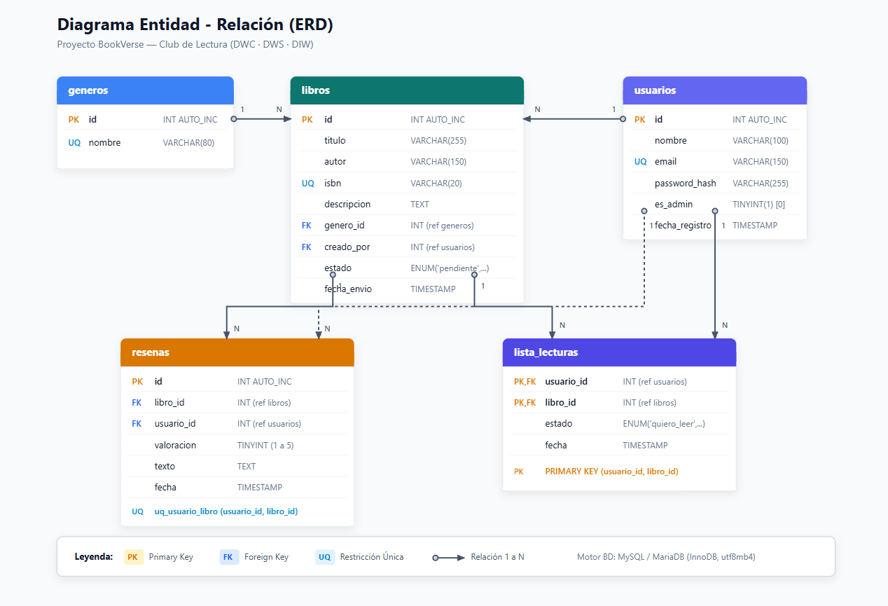
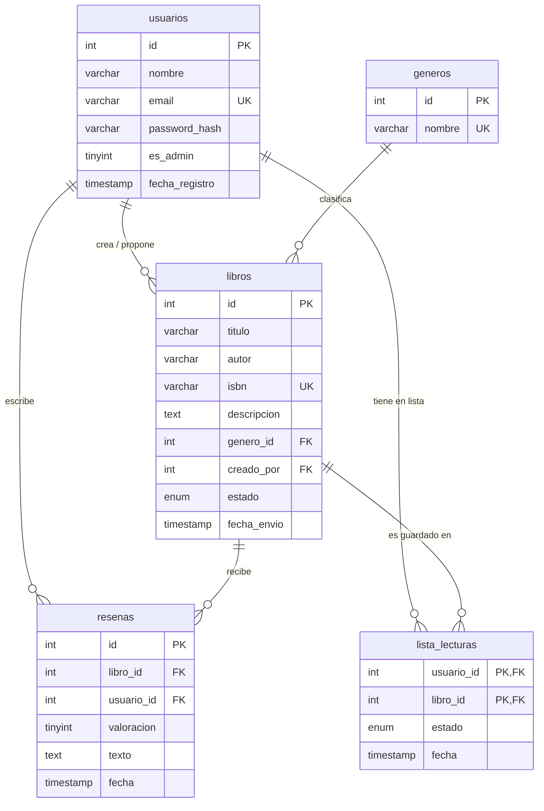

# Modelo de Datos — BookVerse

Este documento describe detalladamente la arquitectura de datos relacional para la aplicación web **BookVerse**, incluyendo sus tablas, tipos de datos, claves primarias y foráneas, restricciones de integridad y reglas de negocio aplicadas.

---

## 1. Diagrama Entidad - Relación (ERD)

A continuación se muestra el esquema visual del modelo de datos:

### Representación en formato Mermaid

---

## 2. Descripción Detallada de las Tablas

### 2.1. Tabla `usuarios`
Almacena las cuentas de usuario de la plataforma (tanto lectores convencionales como la cuenta de administración).

| Campo | Tipo | Nulo | Por defecto | Clave / Restricción | Descripción |
| :--- | :--- | :---: | :---: | :---: | :--- |
| `id` | `INT UNSIGNED` | NO | *AUTO_INCREMENT* | **PRIMARY KEY** | Identificador único del usuario. |
| `nombre` | `VARCHAR(100)` | NO | Ninguno | - | Nombre visible del usuario. |
| `email` | `VARCHAR(150)` | NO | Ninguno | **UNIQUE KEY** (`uq_usuario_email`) | Correo electrónico de acceso al sistema (único). |
| `password_hash` | `VARCHAR(255)` | NO | Ninguno | - | Hash seguro de la contraseña generado con `password_hash()` (BCRYPT / Argon2id). |
| `es_admin` | `TINYINT(1)` | NO | `0` | - | Booleano (`0` = Lector normal, `1` = Administrador con acceso a moderación). |
| `fecha_registro`| `TIMESTAMP` | NO | `CURRENT_TIMESTAMP` | - | Momento exacto del registro del usuario. |

* **Reglas de seguridad e integridad:**
  * El formulario público de registro asigna siempre `es_admin = 0`.
  * La cuenta de administrador se genera únicamente a través del script de inicialización (`docs/sql/schema.sql`).
  * El email es único para evitar duplicidades de cuenta.

---

### 2.2. Tabla `generos`
Almacena las categorías literarias disponibles para clasificar los libros.

| Campo | Tipo | Nulo | Por defecto | Clave / Restricción | Descripción |
| :--- | :--- | :---: | :---: | :---: | :--- |
| `id` | `INT UNSIGNED` | NO | *AUTO_INCREMENT* | **PRIMARY KEY** | Identificador único del género. |
| `nombre` | `VARCHAR(80)` | NO | Ninguno | **UNIQUE KEY** (`uq_genero_nombre`) | Denominación del género literario (ej: Ficción, Ensayo, Terror, Fantasía). |

* **Reglas de integridad:**
  * No se permite duplicar nombres de género.
  * Los libros vinculados a un género impiden su eliminación accidental (`ON DELETE RESTRICT`).

---

### 2.3. Tabla `libros` (Entidad Principal)
Contiene la información de los libros del catálogo, tanto los publicados como aquellos pendientes de moderación o rechazados.

| Campo | Tipo | Nulo | Por defecto | Clave / Restricción | Descripción |
| :--- | :--- | :---: | :---: | :---: | :--- |
| `id` | `INT UNSIGNED` | NO | *AUTO_INCREMENT* | **PRIMARY KEY** | Identificador único del libro. |
| `titulo` | `VARCHAR(255)` | NO | Ninguno | - | Título de la obra literaria. |
| `autor` | `VARCHAR(150)` | NO | Ninguno | - | Nombre completo del autor o autora. |
| `isbn` | `VARCHAR(20)` | NO | Ninguno | **UNIQUE KEY** (`uq_libro_isbn`) | Código normalizado internacional (ISBN-10 o ISBN-13). |
| `descripcion` | `TEXT` | NO | Ninguno | - | Sinopsis o descripción del libro. |
| `genero_id` | `INT UNSIGNED` | NO | Ninguno | **FOREIGN KEY** -> `generos(id)` | Género al que pertenece el libro. |
| `creado_por` | `INT UNSIGNED` | NO | Ninguno | **FOREIGN KEY** -> `usuarios(id)` | Usuario que propuso o dio de alta el libro. |
| `estado` | `ENUM('pendiente', 'publicado', 'rechazado')` | NO | `'pendiente'` | - | Estado en el flujo de moderación. |
| `fecha_envio` | `TIMESTAMP` | NO | `CURRENT_TIMESTAMP` | - | Fecha y hora en la que se envió la propuesta del libro. |

* **Reglas de integridad y moderación:**
  * `FOREIGN KEY (genero_id) REFERENCES generos(id) ON UPDATE CASCADE ON DELETE RESTRICT`: Evita borrar géneros que contienen libros.
  * `FOREIGN KEY (creado_por) REFERENCES usuarios(id) ON UPDATE CASCADE ON DELETE RESTRICT`: Mantiene la auditoría de quién propuso el libro.
  * **Visibilidad pública:** Las vistas de catálogo general, buscador, filtros por género y detalle únicamente consultan libros con `estado = 'publicado'`.
  * **Moderación:** Los libros propuestos por los usuarios entran con estado `'pendiente'`. El administrador es el único con potestad de cambiar el estado a `'publicado'` o `'rechazado'` desde la vista de moderación.

---

### 2.4. Tabla `resenas` (Entidad Relacionada)
Almacena las críticas y puntuaciones que los usuarios con sesión publican sobre libros ya publicados.

| Campo | Tipo | Nulo | Por defecto | Clave / Restricción | Descripción |
| :--- | :--- | :---: | :---: | :---: | :--- |
| `id` | `INT UNSIGNED` | NO | *AUTO_INCREMENT* | **PRIMARY KEY** | Identificador único de la reseña. |
| `libro_id` | `INT UNSIGNED` | NO | Ninguno | **FOREIGN KEY** -> `libros(id)` | Libro sobre el que se redacta la opinión. |
| `usuario_id` | `INT UNSIGNED` | NO | Ninguno | **FOREIGN KEY** -> `usuarios(id)` | Usuario autor de la reseña. |
| `valoracion` | `TINYINT UNSIGNED` | NO | Ninguno | **CHECK** (`valoracion BETWEEN 1 AND 5`) | Puntuación numérica en estrellas de 1 a 5. |
| `texto` | `TEXT` | NO | Ninguno | - | Contenido textual de la reseña. |
| `fecha` | `TIMESTAMP` | NO | `CURRENT_TIMESTAMP` | - | Fecha de publicación o última edición. |

* **Restricciones de Integridad y Claves:**
  * **Restricción de unicidad:** `UNIQUE KEY uq_usuario_libro (usuario_id, libro_id)`. Cada usuario puede publicar como máximo **una reseña por libro**.
  * `FOREIGN KEY (libro_id) REFERENCES libros(id) ON DELETE CASCADE`: Si un libro publicado es eliminado por el administrador, se eliminan en cascada sus reseñas asociadas.
  * `FOREIGN KEY (usuario_id) REFERENCES usuarios(id) ON DELETE CASCADE`: Si un usuario es eliminado, se suprimen sus reseñas.
  * **Cálculo de puntuación media:** La nota media de un libro se calcula dinámicamente mediante `SELECT AVG(valoracion) FROM resenas WHERE libro_id = ?`.

---

### 2.5. Tabla `lista_lecturas`
Gestiona la lista personal de seguimiento de lecturas de cada usuario registrado (relación Muchos a Muchos entre `usuarios` y `libros`).

| Campo | Tipo | Nulo | Por defecto | Clave / Restricción | Descripción |
| :--- | :--- | :---: | :---: | :---: | :--- |
| `usuario_id` | `INT UNSIGNED` | NO | Ninguno | **PRIMARY KEY**, **FOREIGN KEY** -> `usuarios(id)` | Usuario propietario de la lista. |
| `libro_id` | `INT UNSIGNED` | NO | Ninguno | **PRIMARY KEY**, **FOREIGN KEY** -> `libros(id)` | Libro incorporado a la lista. |
| `estado` | `ENUM('quiero_leer', 'leyendo', 'leido')` | NO | `'quiero_leer'` | - | Progreso de lectura del usuario respecto a ese libro. |
| `fecha` | `TIMESTAMP` | NO | `CURRENT_TIMESTAMP ON UPDATE CURRENT_TIMESTAMP` | - | Fecha en la que se añadió o se modificó el estado. |

* **Restricciones de Integridad y Claves:**
  * **Clave Primaria Compuesta:** `PRIMARY KEY (usuario_id, libro_id)`. Un libro no puede repetirse dentro de la lista de un mismo usuario.
  * `FOREIGN KEY (usuario_id) REFERENCES usuarios(id) ON DELETE CASCADE`.
  * `FOREIGN KEY (libro_id) REFERENCES libros(id) ON DELETE CASCADE`.
  * Solo los libros con estado `'publicado'` pueden añadirse a la lista personal de lecturas.

---

## 3. Matriz de Relaciones y Cardinalidades

| Entidad Origen | Cardinalidad | Entidad Destino | Clave Foránea | Política ON DELETE | Propósito |
| :--- | :---: | :--- | :--- | :--- | :--- |
| `generos` | **1 : N** | `libros` | `libros.genero_id` | `RESTRICT` | Clasificar libros por género literario. |
| `usuarios` | **1 : N** | `libros` | `libros.creado_por` | `RESTRICT` | Auditoría de autoría en propuestas de libros. |
| `libros` | **1 : N** | `resenas` | `resenas.libro_id` | `CASCADE` | Asociar valoraciones y opiniones a un libro. |
| `usuarios` | **1 : N** | `resenas` | `resenas.usuario_id` | `CASCADE` | Vincular las reseñas a su autor. |
| `usuarios` | **N : M** | `libros` | `lista_lecturas` | `CASCADE` | Tabla intermedia para el seguimiento personal de lecturas. |

---

## 4. Parámetros Técnicos del Motor de Base de Datos

* **Motor de Almacenamiento:** `InnoDB` (permite claves foráneas, integridad referencial y transacciones ACID).
* **Juego de caracteres:** `utf8mb4` (soporte completo de caracteres internacionales, tildes y símbolos).
* **Collation:** `utf8mb4_unicode_ci` (búsquedas y ordenaciones insensibles a mayúsculas/minúsculas y acentos adecuados al español).
